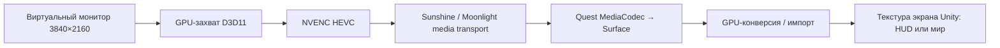

# Видеопоток 4K60: исследование и выбранное направление

Дата: 12.11.2026. Основной режим по выбору пользователя — **3840×2160, 60 FPS**.
Допустимый резервный режим — **3840×2160, 30 FPS**. Приоритет — читаемость текста;
понижать разрешение автоматически при изменении физического размера окна в VR не следует.

**Вывод:** основной тракт нужно заменить на аппаратное видео: виртуальный монитор Windows →
GPU-захват → NVENC HEVC → транспорт Sunshine/Moonlight → аппаратный MediaCodec на Quest →
GPU-текстура Unity. JPEG-поток остаётся существующим прототипом до прохождения приёмки замены.
60 FPS в приложении пока не достигнуты. Это исследование и техническое решение, не отчёт о готовой реализации.

## Что проверено на этом оборудовании

| Узел | Фактический результат |
|---|---|
| ОС ПК | Windows 11 Pro, build 26300 |
| Основная GPU | GeForce RTX 2080, драйвер 610.88 |
| Вторая GPU | AMD Radeon Graphics; захват и кодирование следует привязать к RTX, исключая межадаптерные копии |
| Физический монитор | 1920×1080, текущая частота около 143 Гц |
| Активный Ethernet, повторная проверка | Marvell AQtion 10Gbit, интерфейс Ethernet 2, согласованный линк **1 Гбит/с** |
| Quest Wi-Fi | 5 ГГц, 5180 МГц; один снимок RSSI −71 dBm, PHY link speed 648 Мбит/с |
| Quest | Android API 34; аппаратные AVC, HEVC и AV1 декодеры Qualcomm |
| Низкая задержка | Отдельные `c2.qti.*.decoder.low_latency`; заявленный предел битрейта **70 Мбит/с** |
| 4K60 | `areSizeAndRateSupported(3840, 2160, 60)` возвращает true для AVC/HEVC/AV1 low-latency декодеров |

CodecCapabilities получены непосредственно с подключённого Quest отдельной read-only утилитой
[AndroidCodecProbe.java](../tools/AndroidCodecProbe.java). APK приложения не заменялся,
декодеры не запускались, системный видеодрайвер не устанавливался. Сводка:
[quest3-codec-capabilities.json](quest3-codec-capabilities.json). Объявленные возможности API
не являются измерением устойчивой производительности всего тракта.

Поддержка RTX 2080 по [матрице NVIDIA](https://developer.nvidia.com/video-encode-decode-support-matrix):
аппаратное кодирование H.264 и HEVC доступно, AV1 encoding отсутствует. Поэтому основной кодек — HEVC,
H.264 — резерв совместимости. Наличие AV1 decoder в Quest не создаёт AV1 encoder на ПК.

PHY-скорость Wi-Fi не равна полезной пропускной способности. При повторной проверке маршрут
до Quest проходит через Ethernet 2 с линком **1 Гбит/с**, IP ПК 192.168.0.163.
Упомянутые ранее 100 Мбит/с были прочитаны из состояния Intel Ethernet при первоначальном
замере; теперь этот адаптер отключён. Это не измерение тарифа провайдера и не ограничение
текущего LAN-маршрута. Скорость интернет-тарифа относится к WAN, а не к потоку внутри LAN.
Для выбранного битрейта 50–65 Мбит/с гигабитный проводной линк даёт достаточный номинальный
запас; полезную скорость и стабильность беспроводного участка следует измерять отдельно.

## Почему текущий поток ограничен

Реальный источник сейчас Full HD. Увеличение Unity-текстуры или окна не создаёт деталей выше 1920×1080.
Нужен рабочий стол Windows с исходным разрешением 3840×2160.

На ПК измерен действующий `mss → Pillow JPEG Q97 4:4:4` без сохранения снимков:
30 кадров после прогрева, текущее содержимое рабочего стола.

| Показатель | Результат |
|---|---:|
| Захват, медиана | 13,56 мс |
| Захват + JPEG, медиана | 20,99 мс |
| Захват + JPEG, p95 | 22,92 мс |
| Размер JPEG, медиана | 348 877 байт |
| Расчётный битрейт этих же кадров при 60 FPS | 167,46 Мбит/с |

Воспроизведение замера: `.\.venv\Scripts\python.exe tools\profile_capture.py`.
Это профиль конкретного содержимого экрана, не универсальная скорость JPEG.
Уже этот этап занимает больше бюджета 16,67 мс на кадр при 60 FPS,
а расчётный битрейт JPEG существенно выше бюджета предлагаемого HEVC-потока.

Далее текущий протокол ждёт завершения передачи, декодирования и загрузки текстуры,
прежде чем захватывать следующий кадр. Таким образом, частота определяется суммой задержек,
включая RTT, вместо параллельной работы стадий. Перенос JPEG в рабочий поток освободил интерфейс,
но не превратил JPEG в аппаратный поток видео.

После декодирования идут RGBA-копии через CPU. Для 4K60 одна полная копия RGBA —
3840×2160×4×60 = **1,99 ГБ/с**. Несколько копий и Java/C# границы умножают нагрузку.
Повышать разрешение и параметр `--fps` у этого тракта недостаточно.

## Виртуальный монитор

Windows должен получить отдельный display target, который участвует в обычном режиме
«Расширить эти экраны». Это задача [Indirect Display Driver / IddCx](https://learn.microsoft.com/en-us/windows-hardware/drivers/display/indirect-display-driver-model-overview),
а не кодека и не Unity-камеры.

Практический кандидат — [VirtualDrivers Virtual Display Driver](https://github.com/VirtualDrivers/Virtual-Display-Driver):
проект поддерживает виртуальные мониторы, свои разрешения/частоты, EDID и выбор render adapter.
Вместо разработки собственного драйвера следует выбрать релиз, проверить его подпись и установочный путь,
затем создать один монитор с режимами 3840×2160@60 и @30. Установка требует административных прав.
В рамках исследования драйвер не скачивался и не устанавливался; доверие подписи конкретного релиза ещё не проверено.

Предлагаемое поведение: монитор привязан к RTX 2080; физический монитор остаётся рабочим,
приложение передаёт выбранный виртуальный display по его стабильному идентификатору.
Разрешение виртуального рабочего стола согласуется с настройками сессии, а не с размером VR-прямоугольника.

## Выбор транспорта и компонентов

| Вариант | Оценка для проекта |
|---|---|
| Существующий JPEG/TLS | Не основной путь к 4K60: последовательные стадии, CPU, большой битрейт |
| Свой FFmpeg/NVENC + простой TCP | Кодек ускоряет сжатие, но собственный тракт ещё требует pacing, восстановления потерь, ограниченных очередей и безопасности |
| Unity WebRTC | Android и MediaCodec поддерживаются, но официальный пакет сейчас помечен deprecated; не выбирать его новой основной зависимостью |
| Sunshine + встроенный Moonlight client core | Предпочтительный путь: готовые GPU-захват/NVENC, транспорт, pairing и обработка потерь; собственная интеграция вывода в Unity |

Источники: [возможности Sunshine](https://docs.lizardbyte.dev/projects/sunshine/latest/),
[Moonlight Streaming Core](https://github.com/moonlight-stream/moonlight-common-c),
[статус Unity WebRTC](https://github.com/Unity-Technologies/com.unity.webrtc),
[Android hardware decoder factory Unity WebRTC](https://github.com/Unity-Technologies/com.unity.webrtc/blob/main/Plugin~/WebRTCPlugin/Android/AndroidCodecFactoryHelper.cpp).

Это встраивание клиента в **наше приложение**, не запуск отдельного окна Moonlight вместо HUD.
`moonlight-common-c` предназначен для собственных клиентов; JNI/MediaCodec-слой удобно сверять с
[Moonlight Android](https://github.com/moonlight-stream/moonlight-android/blob/master/app/src/main/java/com/limelight/binding/video/MediaCodecDecoderRenderer.java).
Обе библиотеки Moonlight имеют GPL-3.0: перед включением исходников/линковкой нужно учесть лицензию
в поставке приложения. В этом исследовании они не добавлены в сборку.

Sunshine может выбирать отдельный display, менять его режим и кодировать NVENC;
для WAN предусмотрено требование шифрования. Настройки —
[официальная конфигурация Sunshine](https://docs.lizardbyte.dev/projects/sunshine/latest/md_docs_2configuration.html).
Предлагается привязывать capture к виртуальному монитору, сохранять HDR выключенным для первого SDR-тракта,
а для интернет-сессии требовать шифрование, а не полагаться только на белый IP.

## Аппаратный вывод в Unity — основной технический риск

Нужно вывести декодированный кадр в Android Surface, затем в GPU-текстуру Unity без `BitmapFactory`,
`getPixels`, `ReadPixels`, Java/C# RGBA-массивов и `LoadRawTextureData` в рабочем тракте.
Одна GPU-конверсия YUV/OES → RGBA допустима; это не CPU readback.

Текущий проект использует Vulkan. Нельзя считать Android Surface готовой Unity-текстурой.
Варианты интеграции нужно разделить заранее:

- Сохранение Vulkan: нативный plugin, external-memory/AHardwareBuffer interop, корректные fences и lifetime.
- GLES3: MediaCodec → SurfaceTexture/OES → GPU-copy в Unity texture на render thread.
  Это более простой резервный путь интеграции, но смена backend требует повторной проверки passthrough,
  прозрачности HUD, обеих глазных проекций и управления руками.

Сначала нужно подтвердить именно этот участок на 4K60; объявленная MediaCodec capability его не проверяет.
Работающий интерфейс и математика захватов остаются независимыми от выбранного видеобэкенда.

## Начальный профиль и честные границы качества

- 3840×2160@60, SDR, HEVC Main 8-bit, аппаратный NVENC и аппаратный low-latency MediaCodec.
- Начальный LAN-битрейт 50 Мбит/с; настройка качества в пределах объявленного decoder cap 70 Мбит/с.
  Это стартовый бюджет для измерения, не обещание идеального качества при любом содержимом.
- Низкая задержка: ограниченные очереди, отсутствие B-frame reorder/длинного lookahead,
  параллельные capture/encode/network/decode/render. Не ждать подтверждения показа каждого кадра перед capture.
- H.264 остаётся резервом совместимости. При недостижимости 60 FPS сначала предлагается 4K30,
  сохраняя приоритет исходного разрешения; режимы ниже минимума должны явно считаться не прошедшими приёмку.

Основной аппаратный путь ожидается в YUV 4:2:0. NVENC умеет больше профилей, чем аппаратный decoder Quest;
поддержку 4:4:4 нельзя обещать по одним возможностям GPU. Цветной мелкий текст может пострадать
от chroma subsampling, даже когда чёрно-белые границы хорошо сохранены. Нужны тесты текста и цветовых таблиц,
корректная color matrix/range и достаточный битрейт. Увеличение битрейта не превращает 4:2:0 в 4:4:4.

Также 4K рабочего стола не означает 3840 видимых пикселей по ширине небольшого VR-окна.
Результат зависит от углового размера экрана, eye render resolution, фильтрации и физических панелей Quest.
Проверять читаемость нужно в реальном рабочем размере, а не только по metadata потока.

## Последовательность реализации и приёмка

1. Изолированный аппаратный receive/render bridge на Quest: реальные счётчики decoded/rendered frames,
   аппаратное имя decoder, timestamps, отсутствие CPU readback. Не менять пока управление руками.
2. Аппаратный host на RTX 2080, HEVC, отдельные метрики capture/encode/network/decode/render.
   Проверка 4K60 тестового движущегося материала в существующей сцене, затем реального рабочего стола.
3. Установка проверенного VDD и настройка расширенного рабочего стола 4K60/4K30, захват только этого монитора.
4. Стабильный LAN-прогон 10 минут: 60 FPS цель, 30 FPS минимум в движущихся сценах;
   p50/p95 frame interval, drops/repeats, bitrate, thermal throttling, VR frame misses.
   Счётчик VR-кадров не подменяет счётчик новых видеокадров.
5. Текст/скроллинг/курсор/видео, HUD с alpha 0/0.5/1, движение головы, все ручные захваты,
   сон/пробуждение, отключение, восстановление ключевого кадра после потерь.
6. После LAN — WAN: pairing/обязательное шифрование, ограничение битрейта по реальной полосе,
   проверка packet loss/jitter; отдельный замер end-to-end задержки камерой или тестом с общими часами.

Принятие результата: обычный второй монитор Windows с исходным 4K, аппаратное видео в нашем HUD,
устойчивая частота не ниже 30 и целевые 60 FPS, без возврата мерцания и отказов ручного управления.
Заявленные возможности железа — основание для этой архитектуры; достижение этих критериев
должно быть подтверждено интеграционными измерениями, а не выставленным параметром `fps=60`.
